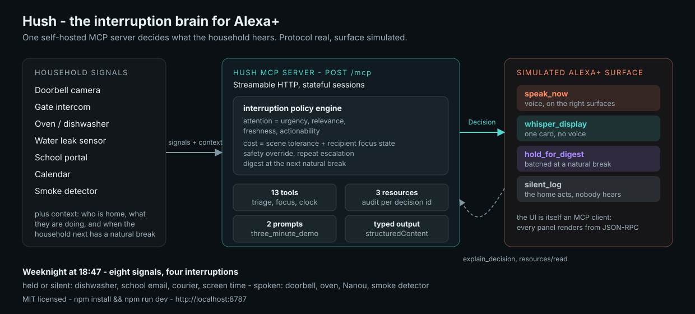

# Hush - the interruption brain for Alexa+

**Track:** Alexa+ · **Mini challenge:** Open Source (MIT) · **Demo video:** 2:55

> Every connected device in a house has a speaker it can borrow, and none of them knows
> whether anyone can hear it right now. Hush gives Alexa+ that judgement: a self-hosted
> MCP server that reads household context and decides, per signal, whether the assistant
> should **say it out loud**, **whisper it to one screen**, **hold it for the next natural
> break**, or **handle it without a word** - and can explain the choice afterwards.



## The 30-second story

It is 18:47 on a weeknight. The documentary is paused, Lina is 20 minutes into math
homework, Mathieu is on a hackathon call with his door shut, Ana is searing something.
In the next two minutes eight signals land: dishwasher done, a school admin email, a
no-signature courier, the doorbell, the oven timer, a screen-time warning, Nanou at the
gate, and the kitchen smoke detector.

A smart home that treats all eight as notifications interrupts a family six times and
misses the one thing that matters. Hush routes them:

| Signal | Route | Why |
| --- | --- | --- |
| Dishwasher done | `silent_log` | attention 24.6 < interruption cost 34 |
| Swimming kit due Friday | `hold_for_digest` | Lina is focused; nobody free can read a card |
| No-signature courier | `hold_for_digest` | worth knowing, not worth waking the office for |
| Doorbell, unknown package | `speak_now` (+33.9) | Ana is free in the kitchen, actionable now |
| Oven timer | `speak_now` (+36.5) | food is burning, kitchen light pulses |
| Screen time +6 min | `hold_for_digest` | parent is `do_not_disturb`, kid is focused |
| Nanou at the gate | `speak_now` (+45.3) | a person is outside in the cold |
| Smoke detector | `speak_now` | **safety override**, no policy can suppress it |

Nothing here is a vibes-based LLM output. The score is arithmetic, every factor is
readable by a tool call, and the same engine works for any MCP-capable assistant.

## Run it

```bash
npm install
npm run dev          # builds with tsc, then serves on http://localhost:8787
```

| Surface | URL |
| --- | --- |
| Simulated Alexa+ experience | http://localhost:8787 |
| Simulated Alexa+ experience, self-playing | http://localhost:8787/?autoplay=1 |
| MCP endpoint (Streamable HTTP) | http://localhost:8787/mcp |
| Health + active sessions | http://localhost:8787/health |

Verify:

```bash
npm test         # 36 tests: the policy engine, plus MCP over the real transport
npm run smoke    # HTTP + a real MCP session, the full scene, and the digest beat
npm run probe    # drives the endpoint like an MCP client and prints the routing table
npm run typecheck
```

Point a real MCP client at it (see `configs/mcp-clients.json`):

```bash
claude mcp add --transport http hush http://localhost:8787/mcp
```

## What the demo screen does

The browser page is not a mock that calls a REST shortcut. It is an **MCP client**: it opens a
session (`initialize` + `notifications/initialized`), reads the household through
`resources/read`, triages signals with `tools/call`, and re-reads the scoring of any ledger
row on click. The console at the bottom prints every JSON-RPC call with latency, so you can
see that the experience and the tools are the same code path.

- **Scenario bar** - four households in time: weeknight, movie night, bedtime, guest arrival.
- **Household context** - who is home and their focus state. Click a focus chip: the next
  triage reacts immediately.
- **Simulated Alexa+ surface** - the ring shows whether the assistant spoke, whispered, or
  stayed quiet; the transcript is the running narration for the video.
- **Decision ledger** - every routing decision with its net score; click to replay the
  factors. When a repeated signal changes its own verdict the row keeps the old route struck
  through plus a `verdict updated` flag, which is the moment the product is arguing for.
- **Play the scene** - runs the whole arc unattended in about fifteen seconds, which is how
  the demo video is recorded (the edit adds the voice-over on top of it).
- **`?autoplay=1`** - starts that scene on load, so a recorder only has to press one key.
- **`Stop scene` / `Reset take`** - the human's escape hatches. Stop interrupts mid-take
  (the scene is ~15s, so a bad take costs seconds, not a re-record); Reset restores the
  scenario exactly, which is what makes the demo repeatable on camera.

## MCP surface

13 tools, 2 static resources, 1 templated resource, 2 prompts.

| Tool | What an assistant uses it for |
| --- | --- |
| `get_home_context` | scene, clock, who is home, focus states, next natural break |
| `list_scenarios` / `load_scenario` | switch or reset the simulated household |
| `get_pending_events` | signals that arrived but have not been triaged |
| `evaluate_interruption` | **the core decision**, typed `structuredContent` result |
| `route_pending_events` | batch triage, returns the routing table |
| `replay_signal` | the same device firing again - escalation instead of permanent silence, and an explicit reason when the valve declines |
| `get_quiet_queue` | what is being held back, and until when |
| `deliver_digest` | speak the held news once the household reaches a break |
| `explain_decision` | audit trail: the scored factors behind one decision |
| `set_person_focus` | household-side policy control (`free`/`focused`/`do_not_disturb`/`asleep`) |
| `advance_home_clock` | move the simulated clock so deferred news becomes due |
| `reset_home_state` | deterministic resets between video takes |

Resources: `hush://home/context`, `hush://quiet-queue`, `hush://decisions/{id}`.
Prompts: `triage_this_signal`, `three_minute_demo` (the latter lets any MCP client run the
hackathon demo by itself).

## The policy, in full

```text
attention  = urgency*0.45 + relevance*0.20 + actionability*0.15 + freshness(<=15)
speakCost  = sceneInterruptCost + focusCost
whisperCost= 0.55*sceneInterruptCost + 0.45*focusCost + 10 if quiet window

focusCost  free 0 | focused 24 | do_not_disturb 38 | asleep 55

1. safety override                    -> speak_now, always
2. deferred twice, and repetition can
   carry it over the bar              -> speak_now. The safety valve is scored, not waved at: it
                                          lifts attention by at least 30, the credit is a factor
                                          on the row, and attention minus what the verdict costs
                                          is the net the row prints. It is capped at 2x what the
                                          signal was ever worth, so a dishwasher cannot escalate
                                          into an alarm - being ignored is news, not a substitute
                                          for mattering
3. attention - speakCost  >= 24       -> speak_now
4. attention >= 30 and somebody free
   and attention - whisperCost >= 10  -> whisper_display (a card pays the cheaper display cost,
                                          so its net is attention - displayCost)
5. attention >= 30                    -> hold_for_digest (next break with tolerance >= 55)
6. otherwise                          -> silent_log
```

Tunables live in one exported object (`src/domain/triage.ts:12`), so a family - or a judge -
can change the personality of the assistant without touching the demo.

## Why this fits the Alexa+ track

- A **real** Streamable HTTP MCP endpoint (official TypeScript SDK), stateful sessions, typed
  outputs, resources and prompts - not a mock mentioned in a README.
- A **simulated Alexa+ experience** on top of it, driven by that same endpoint.
- The interesting part is a *judgement layer*: context-aware interruption routing, which is
  exactly the kind of product thinking the track asks for.
- Explainability is a first-class tool, not a screenshot.

## Repo map

```text
src/domain/types.ts        household, signal, and decision model
src/domain/scenarios.ts    four scripted households-in-time (22 signals)
src/domain/triage.ts       the interruption policy + scored factors
src/domain/state.ts        in-memory household state, ledger, quiet queue, digest
src/mcp/registry.ts        all MCP tools, resources, and prompts
src/server.ts              Express app + stateful Streamable HTTP MCP sessions
src/index.ts               boot
public/index.html|css|js   simulated Alexa+ surface; it is an MCP client
scripts/smoke-test.sh      HTTP + MCP session + the full weeknight arc
scripts/mcp-probe.sh       copy-pasteable raw JSON-RPC calls
tests/                     policy tests + MCP round-trip tests
configs/mcp-clients.json   how to connect a real MCP client
assets/architecture.svg    diagram used in the Devpost field
submission/                Devpost copy, 3-minute script, feedback, friction log, checklist
```

## Recording the demo

`submission/video-script.md` is the shot-by-shot script; `submission/checklist.md` is the
pre-submit gate. You can drive the UI by hand, or let the built-in video studio render the
whole film for you.

### The studio (TTS + Playwright + ffmpeg + rubberband)

`studio/` turns the live app into the demo video end to end — no external recorder:

- `studio/beats.mjs` the 14-beat storyboard: French voice-over, screen state, burned-in
  captions (all four route names appear on screen and are spoken).
- `studio/vo.mjs` voice-over per beat. Uses **edge-tts** when reachable, otherwise falls
  back to a Google read-aloud endpoint; durations are measured with ffprobe.
- `studio/instrument.mjs` injected into the page; it adopts the app's MCP session and can
  replay each beat deterministically (weeknight arc, escalation, digest, bedtime, terminal
  plate of the real `npm run probe` output).
- `studio/capture.mjs` Playwright headless Chromium: drives each beat and screenshots the
  settled DOM, one 1920x1080 keyframe per beat. A screenshot is only allowed once a
  per-beat DOM check proves the claims the narration makes (smoke spoke, verdict struck +
  VERDICT UPDATED, digest held 2, bedtime zero speak_now...); a missing state fails the
  render instead of shipping a lie.
- `studio/assemble.mjs` ffmpeg + rubberband: loops each keyframe over its time-compressed
  voice, concatenates into `submissions/hush-alexa-plus-demo.mp4`, and hard-fails at the
  3:00 cap. It also rebuilds `studio/out/timeline.json` from beats + measured audio if the
  file is missing or stale, so a cleared `studio/out/` never wedges the pipeline.

Fresh install (macOS; `ffprobe` ships with ffmpeg):

```bash
brew install ffmpeg rubberband          # rubberband-cli on Debian/Ubuntu
npm i -D playwright && npx playwright install chromium
python3 -m venv .venv-studio && .venv-studio/bin/pip install edge-tts   # optional; falls back to Google read-aloud
npm run build                           # the studio needs dist/src/index.js
```

```bash
npm run studio:video        # voice + capture + assemble -> a 2:55 .mp4 (~10 MB), cold-start safe:
                            # builds its server if needed, probes it, cleans up what it started
PORT=9123 npm run studio:video   # run the whole studio on an isolated port when a dev
                                 # server already owns 8787 (a server you started is never killed)
```

After editing `studio/beats.mjs`, use the right command — each one only refreshes what it
touches:

- narration (`vo`) changed → `npm run studio:voice` (regenerate audio), then capture if
  captions changed (they come from the narration), then `npm run studio:assemble`;
- screen state (`actions`/`ready`/`reveal`) changed → `npm run studio:capture`, then assemble;
- `captions` only changed → `npm run studio:capture` (captions are painted in the page),
  then assemble;
- timing/experiment only → `SPEED=1.46 npm run studio:assemble` re-cuts durations alone —
  it never re-records voice or screenshots, so a stale narration or frame WILL ship;
- `npm run studio:capture -- --skip-probe` re-shoots frames without re-running the probe
  against a live server (reuse the last `studio/out/probe.txt`).

## Honest limits

For an English video with local macOS speech and no API key, run `node studio/english.mjs`.
It uses the installed Daniel voice at 155 words per minute, English narration and captions,
and renders in an isolated temporary workspace. The output is
`submissions/hush-alexa-plus-demo-en.mp4`; the French version is preserved. Intermediate
English assets are kept in the ignored `studio/out-en/` directory. No global audio acceleration
is applied; the assembler still enforces the three-minute cap.

- Simulated devices: there is no public self-serve way to register a third-party MCP server
  with a real Alexa+ device yet, so the surface is simulated and the protocol is real. See
  `submission/friction-log.md`.
- Household state is in-memory and single-tenant: one household per process, no auth, no
  persistence. Multi-household tenancy, device discovery, and consent are the real work.
- The policy is hand-tuned arithmetic. The obvious next step is learning the weights per
  household from accepted/ignored interruptions.

## License

MIT - see `LICENSE`. Contributions welcome; the policy in `src/domain/triage.ts` is the
part worth arguing about.

## English demo video

[Watch the English demo (2:38)](https://youtu.be/vBLdlksUVwc).
